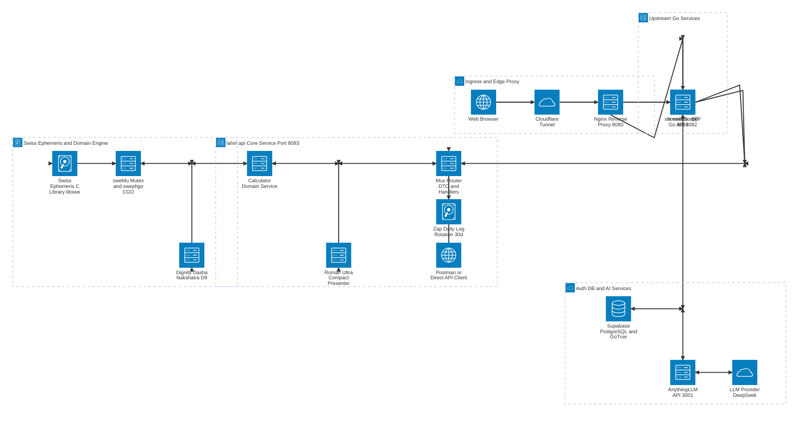

# สถาปัตยกรรมระบบระดับสูง (High-Level System Architecture) — `lahiri-api` Ecosystem

เอกสารนี้อธิบายสถาปัตยกรรมระดับสูง (High-Level Architecture) ของ **`lahiri-api`** (Vedic Astrology & Astronomical Calculation Microservice — พอร์ต `8083`) รวมถึงโครงสร้างภายในและการทำงานร่วมกับบริการอื่น ๆ ที่เกี่ยวข้องในระบบนิเวศเดียวกัน (Ingress / Reverse Proxy, Frontend BFF, Backend Orchestrator, Auth/DB และ AI Inference)

> **หมายเหตุการแสดงผลแผนภาพ:** โค้ด Mermaid ด้านล่างใช้ Syntax แบบ `architecture-beta` ซึ่งรองรับบน **Mermaid v11.1.0+**, **GitHub Markdown**, หรือ **[mermaid.live](https://mermaid.live/)**

---

## 1. แผนภาพสถาปัตยกรรมระดับสูง (`mermaid architecture-beta`)

---

## 2. สถาปัตยกรรมภายในของ `lahiri-api` (Port `8083`)

`lahiri-api` เป็น **Stateless Calculation Microservice** พัฒนาด้วย Go (`1.26.8`) ร่วมกับ CGO (`swephgo v1.1.0`) ไม่มีฐานข้อมูลหรือการเรียก LLM ภายนอกในตัว แต่ทำหน้าที่เป็น Core Astronomical & Astrological Engine ความแม่นยำสูง:

| เลเยอร์ / โมดูล | ไฟล์หลัก | บทบาทและความรับผิดชอบ |
| :--- | :--- | :--- |
| **Entrypoint & HTTP Server** | [`main.go`](./main.go) | เปิดพอร์ต `PORT` (ค่าเริ่มต้น `8083`), ตั้งค่า Timeout (`ReadHeaderTimeout: 5s`, `ReadTimeout: 10s`, `WriteTimeout: 15s`, `IdleTimeout: 60s`), รองรับ Graceful Shutdown (`10s`) และ hook [`RunHoroscopedebug`](./main.go) |
| **Presentation & Routing** | [`internal/api/api.go`](./internal/api/api.go), [`dto.go`](./internal/api/dto.go) | ลงทะเบียน 7 `POST` Endpoints, ตรวจสอบ Method/JSON, แปลงปี พ.ศ. (`> 2400`) เป็น ค.ศ. อัตโนมัติ, ตั้งค่าเริ่มต้น (`house_system="W"`, `time_zone=7.0` สำหรับดาวจร) และ Validate ช่วงข้อมูล |
| **AI Prompt Presenter** | [`internal/api/prompt.go`](./internal/api/prompt.go) | แปลงผลคำนวณเป็นข้อความแบบ **Roman Ultra-Compact** (`FormatRomanCompactPrompt` และ `FormatTransitDashaCompactPrompt`) พร้อม Orb, DeepCombust, Drishti (เกณฑ์พิเศษ/เล็งข้ามภพ), `[nH..->tH..]` และ Pratyantardasha (`PD`) |
| **Domain Orchestration** | [`internal/calculator/service.go`](./internal/calculator/service.go) | ประสานงานคำนวณตาม Use Case: `ComputeHoroscope`, `ComputeDasha`, `ComputeAnnualTransit`, `ComputeMonthTransit`, `ComputeMonthTransitWithDasha`, และ `ComputeTransitDashaPromptData` |
| **Astrology Domain Rules** | [`dignity.go`](./internal/calculator/dignity.go), [`dasha.go`](./internal/calculator/dasha.go), [`nakshatra.go`](./internal/calculator/nakshatra.go), [`navamsa.go`](./internal/calculator/navamsa.go), [`config.go`](./internal/calculator/config.go), [`utils.go`](./internal/calculator/utils.go) | คำนวณมาตรฐานดาว D1/D9 (`Exalted` ถึง `Debilitated`), ดาวดับ (Combust), นวางศ์ D9 (Vargottama), 27 นักษัตรฤกษ์/4 บาท, Whole Sign Houses + เจ้าเรือนเกษตร และวิมโสตรีทศา 120 ปี (MD/AD/PD) |
| **CGO & Concurrency Guard** | [`helpers.go`](./internal/calculator/helpers.go), [`planet.go`](./internal/calculator/planet.go), [`house.go`](./internal/calculator/house.go) | ครอบการเรียก `swephgo` ด้วย `sweMu` (`sync.Mutex`) เพื่อป้องกัน Data Race บน Global State ของ C Library (`libswe-dev`) พร้อมคำนวณ Julian Day (UTC) และ Lahiri Ayanamsa |
| **Observability / Logging** | [`logger.go`](./logger.go) | ใช้ `zap` + `file-rotatelogs` แบบ Tee ลง Console และไฟล์ `logs/app-YYYY-MM-DD.log` (สร้าง symlink `logs/app.log`) หมุนไฟล์รายวันทุก 24 ชม. เก็บย้อนหลัง **30 วัน** |

### API Endpoints ของ `lahiri-api`
- `POST /api/v1/hora/calculate` — คำนวณพื้นดวงฉบับสมบูรณ์ (Metadata, Planets, Angles, Whole Sign Houses, Vimshottari Dasha)
- `POST /api/v1/hora/dasha` — คำนวณเฉพาะวิมโสตรีทศา (รองรับ `transit_year` / `transit_month` และปรับวันสิ้นเดือนอัตโนมัติ)
- `POST /api/v1/hora/prompt` — สร้างข้อความ Roman Ultra-Compact สำหรับป้อน LLM (`JSON` หรือ `?format=raw` / `Accept: text/plain`)
- `POST /api/v1/hora/transit` — คำนวณดาวจร 12 เดือนในปีจรเทียบลัคนากำเนิด
- `POST /api/v1/hora/transitmonth` — คำนวณดาวจรเฉพาะเดือนที่ระบุ
- `POST /api/v1/hora/transitdasha` — คำนวณดาวจรเฉพาะเดือนพร้อมทศา/อนุทศา ณ เวลาดาวจร
- `POST /api/v1/hora/transitdasha_prompt` — สร้างข้อความ Prompt ดาวจร + ทศาจร + TransitConj + TransitDrishti (`JSON` หรือ Plain Text)

---

## 3. บริการอื่น ๆ ที่ทำงานร่วมกับ `lahiri-api`

| บริการ / องค์ประกอบ | พอร์ต / เส้นทาง | ความสัมพันธ์กับ `lahiri-api` และระบบรวม |
| :--- | :--- | :--- |
| **Cloudflare Tunnel (`cloudflared`)** | Tunnel Ingress → Edge | รับทราฟฟิกจากอินเทอร์เน็ต/Web Browser เข้ามายังเครื่องเซิร์ฟเวอร์ภายในอย่างปลอดภัย |
| **Nginx Reverse Proxy** | HTTP `:8080` | ส่ง Path `/` ไปที่ `ssr-web` (`127.0.0.1:8081`) และส่ง Path `/api/` ไปที่ `horaveda-app` (`127.0.0.1:8082/api/`) *(ใช้ IPv4 `127.0.0.1` เพื่อเลี่ยง TCP timeout `[::1]` บน Windows)* |
| **`ssr-web` (Go BFF & SSR Gateway)** | HTTP `:8081` (`HORA_SERVICE_URL`) | เสิร์ฟหน้าเว็บ SSR และทำหน้าที่ Proxy คำขอ `/api/v1/hora/calculate` และ `/api/v1/hora/dasha` (รวม `/hora/*`) มายัง `lahiri-api` (`:8083`) พร้อมเชื่อม `horaveda-app` (`:8082`) สำหรับตรวจสิทธิ์/เซสชัน 15 นาที |
| **`horaveda-app` (Go Backend Orchestrator)** | HTTP `:8082` (`HORA_API_URL`, `HORA_TRANSIT_API_URL`) | จัดการลงทะเบียน Serial Key และ JWT ร่วมกับ **Supabase** (`PostgreSQL` + `GoTrue`), เรียก **`lahiri-api`** ที่ `/api/v1/hora/prompt` และ `/api/v1/hora/transitdasha_prompt` *(ใช้ `sync.WaitGroup` เรียกพร้อมกันแบบ Concurrent สำหรับดวงจร)* เพื่อนำไปพยากรณ์ต่อ |
| **Supabase (PostgreSQL & GoTrue Auth)** | HTTPS (`horaveda-app` ใช้งาน) | เก็บตาราง `users`, `serial_keys` และบัญชี `auth.users` สำหรับระบบยืนยันตัวตน (ไม่เชื่อมต่อกับ `lahiri-api` โดยตรง) |
| **AnythingLLM API & LLM Provider** | HTTP `:3001/api/v1` (DeepSeek ฯลฯ) | รับ Prompt โหราศาสตร์ที่ประกอบจากผลลัพธ์ของ `lahiri-api` เพื่อพยากรณ์ภาษาไทยใน Thread ประจำตัวผู้ใช้ (เรียกผ่าน `horaveda-app` ด้วย Timeout สูงสุด `300s`) |
| **Postman / Direct API Clients** | HTTP `:8083` ([Postman Collection](./lahiri-api.postman_collection.json)) | ทดสอบหรือเรียกใช้งานทุก Endpoint ของ `lahiri-api` ได้โดยตรงโดยไม่ต้องผ่าน Proxy |

---

## 4. ลำดับการทำงานหลักระหว่างบริการ (Key Cross-Service Flows)

1. **การคำนวณพื้นดวงและตารางดาว (BFF → `lahiri-api`):**
   - `Web Browser` → `Cloudflare Tunnel` → `Nginx (:8080)` → `ssr-web (:8081)` ส่ง `POST /api/v1/hora/calculate` หรือ `/dasha` มายัง `lahiri-api (:8083)`
   - `lahiri-api` ล็อก `sweMu` คำนวณด้วย `swephgo` (`libswe`), จัดภพ Whole Sign, มาตรฐานดาว D1/D9, วิมโสตรีทศา และส่ง JSON กลับให้ `ssr-web` แสดงผลบนหน้าเว็บ (Zero-Persistence บน Browser `sessionStorage`)
2. **การพยากรณ์ดวงชะตาด้วย AI (`horaveda-app` → `lahiri-api` → `AnythingLLM`):**
   - `Web Browser` ส่งคำขอพยากรณ์ (`/api/v1/hora/predict` หรือ `/transitpredict_1`–`_12`) → `horaveda-app (:8082)` ตรวจสอบ JWT จาก Cookie/Supabase
   - `horaveda-app` เรียก `lahiri-api (:8083)` ที่ `/api/v1/hora/prompt` (และ `/api/v1/hora/transitdasha_prompt` แบบ Concurrent เมื่อเป็นคำพยากรณ์ดาวจร) เพื่อรับสรุปตำแหน่งดาวแบบ Roman Ultra-Compact
   - `horaveda-app` นำ Prompt ที่ได้ไปสร้างคำขอส่งให้ `AnythingLLM (:3001)` → `DeepSeek` แล้วกรองผลลัพธ์ส่งกลับไปยังผู้ใช้งาน
